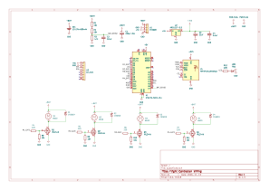

# arduino-quadcopter
~250g quadcopter built from scratch using mechanical design, electronics, and Arduino code

**work in progress project**

This project will contain my work in using SolidWorks to model the frame and KiCad to draw the schematic. Then implementing the designs by soldering on a perfboard, coding with Arduino, and finally assembly with the frame. The goal of the project is to maintain a stable hover.

License : MIT

## Quad Schematic

## Controller Schematic

